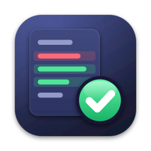
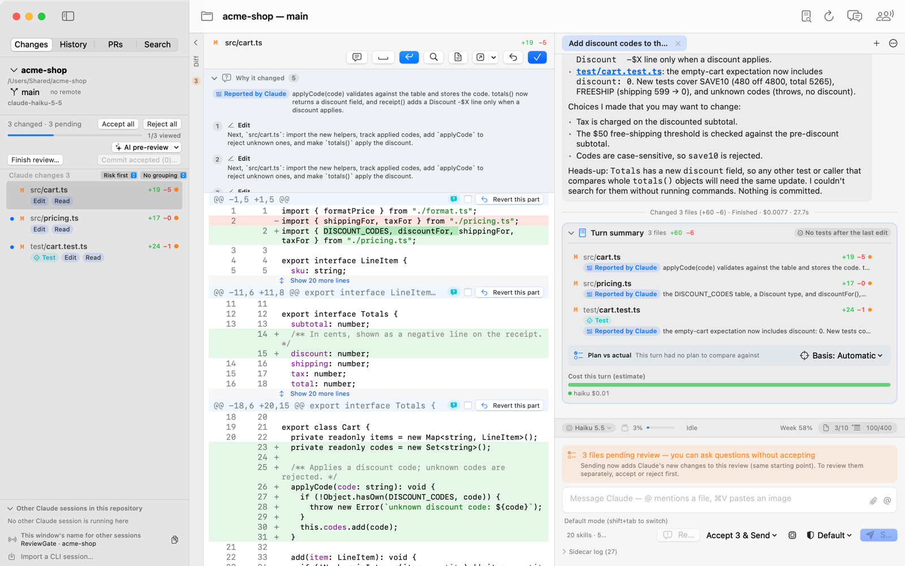
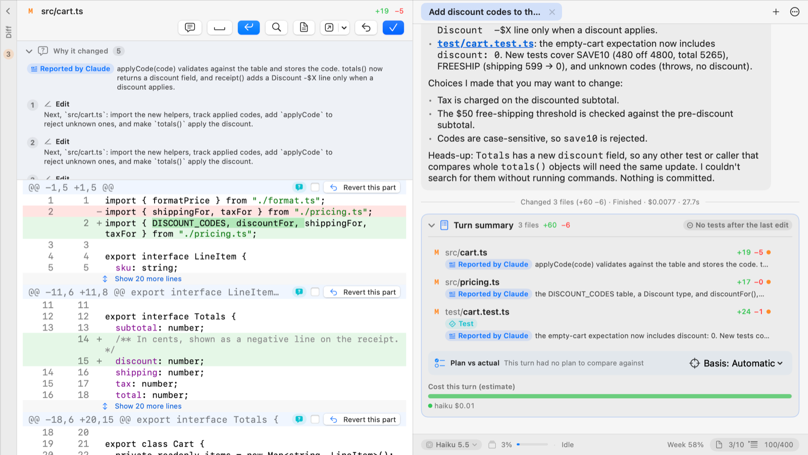
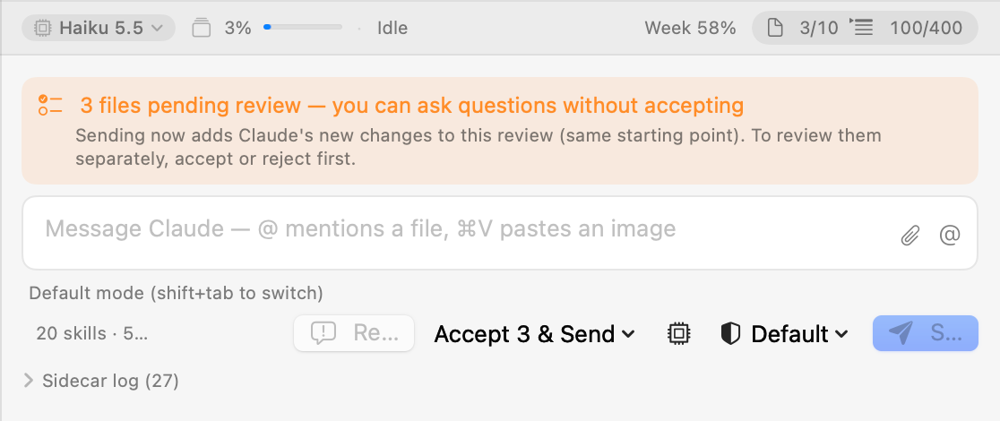
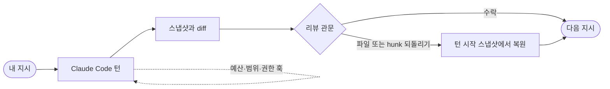

<p align="center">
  
</p>

<h1 align="center">ReviewGate</h1>

<p align="center">
  <b>Claude Code의 턴마다, 다음 지시 전에 리뷰하세요.</b>
</p>

<p align="center">
  
  
  <a href="https://github.com/seunggulee1007/reviewgate-for-claude-code/releases/latest"></a>
  <a href="LICENSE"></a>
</p>

<p align="center">
  <a href="README.md">English</a> · 한국어
</p>

<p align="center">
  <picture>
    <source media="(prefers-color-scheme: dark)" srcset="docs/images/review-dark.png">
    
  </picture>
  <br><sub>턴이 끝난 뒤: 바뀐 파일, diff, 파일·hunk마다 수락과 되돌리기. (화면은 영어 UI)</sub>
</p>

Claude Code는 사람이 읽는 속도보다 훨씬 빨리 코드를 고칩니다. 한 시간쯤 맡겨 두면 바뀐 파일이 마흔 개쯤 쌓이고,
어느 줄이 어느 지시에서 나왔는지 알 수 없게 됩니다.

ReviewGate는 턴과 턴 사이에 관문을 두는 macOS 앱입니다. Claude가 한 턴을 끝내면 무엇이 왜 바뀌었는지 보여 주고,
파일마다 수락하거나 되돌린 뒤에야 다음 지시가 나갑니다.

## 기능

**턴마다 관문.** 바뀐 파일과 diff를 보여 주고, 파일마다(또는 hunk 하나만) 수락하거나 되돌립니다. 수락은 파일을
건드리지 않습니다. 되돌리기는 턴을 시작할 때 찍어 둔 스냅샷에서 파일을 복원하고, 인덱스와 커밋은 그대로 둡니다.

**원할 때 지켜지는 턴 예산.** 켜 두면(기본은 꺼짐) 한 턴이 건드릴 수 있는 파일 수와 변경 줄 수에 상한을 둡니다.
상한은 Claude Code 훅으로 강제되어서, 예산을 넘는 수정은 "자제"가 아니라 거부됩니다.

**왜 바뀌었는지.** 파일마다 그 수정을 만든 도구 호출과 Claude의 설명이 연결됩니다. 턴 요약은 계획과 실제로 한 일을
비교하고, 위험한 변경을 표시하고, 테스트 결과를 보여 줍니다.

**안전장치.** 프로젝트 밖 수정은 먼저 묻고, `.git/` 쓰기는 거부하며, 권한 요청은 터미널 프롬프트 대신 앱 안의 카드로
뜹니다. 임시 폴더의 버리는 파일은 조용히 통과합니다.

**워크벤치.** 한 프로젝트에서 Claude 세션 여러 개를 동시에 돌립니다. 세션마다 git worktree와 브랜치, 관문이 따로
있습니다.

**같은 뷰어로 PR 리뷰.** GitHub·GitHub Enterprise PR을 같은 diff 뷰어로 열고, 라인 코멘트를 남기거나 코멘트 스레드를
Claude에게 넘깁니다.

**되감기, 곁질문, 세션.** 이전 턴에서 지시를 고쳐 다시 시키고, 진행 중인 턴을 흐트러뜨리지 않고 곁질문을 하고,
지난 세션을 리뷰 이력과 함께 이어 갑니다.

**스스로 최신 유지.** 새 릴리스를 알아채고, 내려받은 파일의 체크섬과 서명을 확인한 뒤 그 자리에서 업데이트합니다.

<p align="center">
  <picture>
    <source media="(prefers-color-scheme: dark)" srcset="docs/images/why-dark.png">
    
  </picture>
  <br><sub>파일마다 바뀐 이유와, 비용까지 담은 턴 요약.</sub>
</p>

<p align="center">
  <picture>
    <source media="(prefers-color-scheme: dark)" srcset="docs/images/budget-dark.png">
    
  </picture>
  <br><sub>상태 막대의 턴 예산(파일 3/10, 줄 100/400)과 다음 지시 전에 기다리는 리뷰.</sub>
</p>

## 동작 방식



턴이 시작될 때 작업 트리를 스냅샷으로 찍고(임시 인덱스에 `git write-tree`), 턴이 끝나면 한 번 더 찍어 둘을
비교합니다. 그래서 리뷰에는 정확히 이번 턴만 나옵니다. 내가 커밋하지 않은 작업이나 이전 턴은 섞이지 않습니다.
커밋은 대신 해 주지 않고, 언제 커밋할지는 사용자가 정합니다.

로직은 전부 Claude Code CLI를 움직이는 TypeScript 엔진에 있습니다. macOS 앱(SwiftUI)은 엔진 프로토콜 위의 얇은
클라이언트이고, Windows 클라이언트(Electron, 미리보기)도 같은 엔진을 씁니다.

## 필요한 것

- **macOS 15** 이상
- **[Claude Code](https://claude.com/claude-code)** 설치와 로그인:
  `curl -fsSL https://claude.ai/install.sh | bash` 후 `claude`를 한 번 실행해 `/login`
- **Node.js 24** 이상 — 엔진이 Node로 돌아갑니다. nvm, Homebrew, volta, fnm, asdf, 공식 설치본 어느 것이든 됩니다.
- **Git**
- **[GitHub CLI](https://cli.github.com)**(`gh`), 선택 — PR 리뷰와 앱 내 업데이트에 씁니다.

## 설치

1. [Releases](https://github.com/seunggulee1007/reviewgate-for-claude-code/releases/latest)에서
   `ReviewGate-x.y.z.dmg`를 내려받습니다.
2. 열어서 **ReviewGate**를 **응용 프로그램**으로 끌어 놓습니다. Apple 공증(notarization)을 받은 앱이라 내려받은
   다른 앱처럼 열립니다.

그다음부터는 앱 안에서 업데이트됩니다. 배너의 **설치하고 다시 시작**을 누르면 됩니다.

**Windows(미리보기).** 같은 릴리스에 `ReviewGate-Setup-x.y.z.exe`가 있습니다. 코드 서명이 없어서 처음 실행할 때
SmartScreen이 묻습니다(**추가 정보 › 실행**). 아직 실제 Windows PC에서 써 보지 않았고, 앱 안 업데이트도 없습니다.
확인할 항목은 [docs/M11-WINDOWS.md](docs/M11-WINDOWS.md)에 있습니다.

## 빠르게 시작하기

1. **프로젝트 열기** — 파일 › 프로젝트 열기…(⌘O), Dock 아이콘에 폴더 끌어 놓기, 또는 터미널에서:

   ```sh
   open -a ReviewGate ~/work/my-app
   ```

2. 아래 채팅 칸에 **Claude에게 할 일을 적습니다.** ↩로 보내고, ⇧↩로 줄을 바꿉니다.
3. **턴을 리뷰합니다.** 바뀐 파일을 하나씩 보며 수락하거나 되돌립니다. 리뷰가 끝나면 다음 지시가 나갑니다.
4. 리뷰할 수 있을 만큼 턴을 작게 유지하고 싶다면 **설정 › 일반 › 한도 › 응답당 변경 한도 두기**를 켜고 최대 파일 수와
   최대 변경 줄 수를 정합니다(기본은 꺼짐).

## 소스에서 빌드하기

```sh
brew install xcodegen
make run     # Xcode 프로젝트 생성 → 엔진 사이드카 빌드 → 앱 빌드와 실행
make test    # Swift, 엔진, 사이드카 테스트
```

개발자 인증서 없이 서명하기, 버전과 릴리스, Windows 클라이언트, 실제 CLI 테스트 드라이버, 스크린샷 스크립트는
[docs/DEVELOPMENT.md](docs/DEVELOPMENT.md)(영어)에 있습니다.

## 폴더 구성

| 경로 | 들어 있는 것 |
| --- | --- |
| [`engine/`](engine) | TypeScript 엔진: 리뷰 관문, git 스냅샷, Claude Code 세션과 훅, PR |
| [`sidecar/`](sidecar) | 엔진을 묶어 Mac 앱에 넣는 stdio 어댑터 |
| [`Core/`](Core) | Swift 패키지: 프로토콜 타입, 엔진 클라이언트, 앱 상태 |
| [`App/`](App) | SwiftUI 앱(영어·한국어) |
| [`clients/desktop/`](clients/desktop) | 같은 엔진을 쓰는 Windows용 Electron 클라이언트 |
| [`docs/PROTOCOL.md`](docs/PROTOCOL.md) | 앱과 엔진 사이의 계약 |

## 라이선스

[MIT](LICENSE) © 2026 leeseunggu

ReviewGate는 개인이 만든 독립 프로젝트로, Anthropic과 제휴하거나 Anthropic의 보증을 받지 않았습니다.
Claude와 Claude Code는 Anthropic의 상표입니다.
