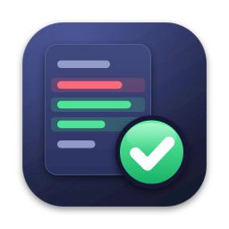
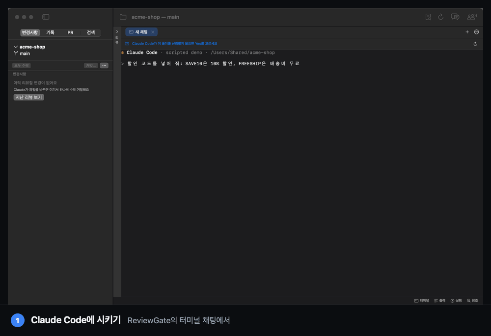
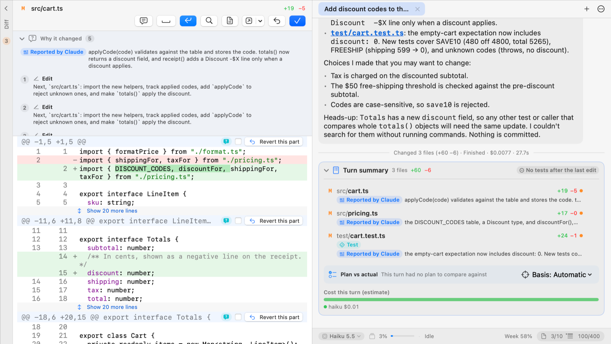

<p align="center">
  
</p>

<h1 align="center">ReviewGate</h1>

<p align="center">
  <b>Claude Code가 바꾼 것을 모두 리뷰하세요 — Claude가 다음으로 넘어가기 전에.</b>
</p>

<p align="center">
  
  
  
  <a href="https://github.com/seunggulee1007/reviewgate-for-claude-code/releases/latest"></a>
  <a href="LICENSE"></a>
</p>

<p align="center">
  <a href="README.md">English</a> · 한국어
</p>

<p align="center">
  
  <br><sub>앱 화면을 그대로 담았습니다. Claude 쪽은 데모용 스크립트라 매번 똑같이 재생됩니다.</sub>
</p>

## 설치

```sh
brew install --cask seunggulee1007/tap/reviewgate
```

Homebrew 가 신뢰하지 않은 tap 이라고 하면 `brew trust seunggulee1007/tap` 을 한 번 실행합니다.

또는 [**Releases**](https://github.com/seunggulee1007/reviewgate-for-claude-code/releases/latest)에서 내려받습니다.

- **macOS 15 이상** — `ReviewGate-x.y.z.dmg`. **응용 프로그램**으로 끌어 놓으면 됩니다. Apple 공증을 받은 앱이라 내려받은
  다른 앱처럼 열립니다.
- **Windows(미리보기)** — `ReviewGate-Setup-x.y.z.exe`. 아직 코드 서명이 없어서 처음 한 번 SmartScreen이 묻습니다
  (**추가 정보 › 실행**).

두 앱 모두 앱 안의 배너로 스스로 업데이트됩니다. Claude Code, Node.js 24 이상, Git도 필요합니다 —
[필요한 것](#필요한-것)을 보세요.

## 왜 ReviewGate인가

Claude Code는 사람이 읽는 속도보다 훨씬 빨리 코드를 고칩니다. 한 시간쯤 맡겨 두면 바뀐 파일이 마흔 개쯤 쌓이고,
어느 줄이 어느 지시에서 나왔는지 알 수 없게 됩니다. ReviewGate는 Claude의 턴과 턴 사이에 리뷰를 둡니다.

- **턴마다 관문.** Claude가 턴을 끝내면 이번 턴이 바꾼 것만 정확히 보여 줍니다 — 내가 커밋하지 않은 작업이나 이전
  턴은 섞이지 않습니다. 파일마다 수락하거나 거절하고, hunk 단위로 부분 되돌리기를 할 수 있습니다.
- **리뷰가 먼저.** 리뷰 대기 파일이 남아 있으면 Claude는 그 파일은 고칠 수 있어도(채팅으로 부탁하거나 메모를 남겨
  변경 요청) 다른 파일로 넘어가지는 못합니다. **모두 수락하고 계속**을 누르면 남은 파일을 수락하고 Claude가 바로
  이어서 작업합니다. 수락한 파일을 Claude가 다시 고치면 수락한 뒤 바뀐 부분만 보여 줍니다.
- **터미널 채팅에서 진짜 Claude Code.** 평소 쓰던 Claude Code TUI가 슬래시 명령, 설정, 로그인 그대로 앱 안에서 돌고,
  리뷰는 그 옆에 열립니다. 채팅 화면이 편하다면 설정 하나로 클래식 채팅을 쓸 수 있습니다.
- **메모 → 변경 요청.** 줄마다 메모를 남기고 한 번에 Claude에게 돌려보냅니다. 무엇을 수락하고 거절했는지도 Claude에게
  전해집니다.
- **git 없이도.** 일반 폴더는 폴더 밖의 숨은 사본으로 추적합니다. git 저장소에서는 커밋, 브랜치, 워크벤치(각자의
  worktree에서 동시에 도는 세션)까지 씁니다.
- **PR 리뷰와 코드 탐색.** GitHub PR을 같은 diff 뷰어로 열고 댓글을 답니다. ⌘-클릭으로 정의 미리 보기, 참조 찾기,
  파일·심볼로 이동합니다.

## 동작 방식

1. **Claude에게 시킵니다.** 프로젝트를 열고 평소처럼 Claude Code와 대화합니다 — 터미널 채팅에서도, 채팅 화면에서도.
2. **턴이 끝나면 리뷰가 열립니다.** ReviewGate는 턴이 시작될 때와 끝날 때 작업 트리를 스냅샷으로 찍고 그 차이를
   보여 줍니다: 바뀐 파일, diff, 그 변경을 만든 도구 호출.
3. **판정하고 이어 갑니다.** 수락, 거절, 부분 되돌리기, 또는 메모를 남겨 변경 요청을 합니다. 거절한 파일은 턴이
   시작될 때 상태로 돌아갑니다. 그다음 Claude가 이어서 작업하고, 다음 프롬프트에는 무엇을 수락·거절했는지가 담깁니다.

커밋은 대신 해 주지 않습니다. 언제 커밋할지는 사용자가 정합니다. 스냅샷은 임시 인덱스에 `git write-tree`로 찍기
때문에 인덱스, 브랜치, 커밋은 건드리지 않습니다.

## 개인정보

코드와 대화는 내 컴퓨터를 떠나지 않습니다. ReviewGate에는 서버도, 계정도, 사용 통계 수집도 없습니다. 앱이 대화하는
상대는 Claude Code(터미널에서 쓸 때와 똑같이 Anthropic과 통신합니다)와, PR(내 `gh`를 통해)과 업데이트 확인을 위한
GitHub뿐입니다.

## 필요한 것

- **macOS 15** 이상, 또는 **Windows**(미리보기)
- **[Claude Code](https://claude.com/claude-code)** 설치와 로그인:
  `curl -fsSL https://claude.ai/install.sh | bash` 후 `claude`를 한 번 실행해 `/login`
- **Node.js 24** 이상 — 엔진이 Node로 돌아갑니다. nvm, Homebrew, volta, fnm, asdf, 공식 설치본 어느 것이든 됩니다.
- **Git**
- **[GitHub CLI](https://cli.github.com)**(`gh`), 선택 — PR, 그리고 Mac의 앱 안 업데이트에 씁니다.

## 자주 묻는 질문

**Claude Code를 대신하나요?** 아닙니다. 이미 설치된 Claude Code를 내 로그인, 설정, skill, MCP 서버 그대로 실행합니다.
ReviewGate는 그 주위에 리뷰를 더할 뿐입니다.

**수락하면 파일이 바뀌거나 커밋되나요?** 아닙니다. 수락은 판정만 기록하고 파일은 Claude가 남긴 그대로 둡니다. 거절은
턴이 시작될 때 찍은 스냅샷으로 파일을 되돌립니다. 커밋은 직접 합니다(앱의 **커밋…** 또는 쓰던 도구).

**관문을 느슨하게 할 수 있나요?** 네. 설정 › 리뷰에서 리뷰 중인 파일만 고치기(기본), 프롬프트까지 막기, 끄기 중에 고릅니다. 막힌 턴은 **이번 턴만 허용**으로 풀 수 있습니다. 턴마다
파일 수와 변경 줄 수에 상한을 두는 턴 예산(기본은 꺼짐)은 설정 › 세션 › 한도에 있습니다.

**비용이 드나요?** ReviewGate는 무료이고 MIT 라이선스입니다. Claude 사용량은 늘 그렇듯 내 Claude Code 요금제로
청구됩니다.

**Windows도 되나요?** 미리보기로 됩니다. 같은 엔진과 리뷰를 Electron 클라이언트로 씁니다. 앱 안에서 업데이트되고,
설치 파일은 아직 코드 서명이 없습니다.

## 더 많은 기능

<p align="center">
  <picture>
    <source media="(prefers-color-scheme: dark)" srcset="docs/images/why-dark.png">
    
  </picture>
  <br><sub>파일마다 바뀐 이유와, 비용까지 담은 턴 요약. (화면은 영어 UI)</sub>
</p>

**왜 바뀌었는지.** 파일마다 그 수정을 만든 도구 호출과 Claude의 설명이 연결됩니다. 턴 요약은 계획과 실제로 한 일을
비교하고, 위험한 변경을 표시하고, 테스트 결과를 보여 줍니다.

**원할 때 지켜지는 턴 예산.** 한 턴이 건드릴 수 있는 파일 수와 변경 줄 수에 상한을 둡니다. Claude Code 훅으로
강제되어서, 예산을 넘는 수정은 "자제"가 아니라 거부됩니다.

**안전장치.** 프로젝트 밖 수정은 먼저 묻고, `.git/` 쓰기는 거부하며, 권한 요청은 앱 안의 카드로 뜹니다. 임시 폴더의
버리는 파일은 조용히 통과합니다.

**리뷰하면서 코드 탐색.** diff나 파일에서 이름을 ⌘-클릭하면 정의를 그 줄 아래 띠로 미리 봅니다 — 읽던 자리는
그대로이고, F12는 그곳으로 이동합니다. ⌘를 누른 채 이름 위에 두면 시그니처가 뜹니다. Java, Kotlin,
JavaScript·TypeScript, Vue, JSP를 먼저 챙겼습니다. 참조는 아래 패널의 참조 탭에 모이고(F4로 하나씩), 파일로
이동(⌘P)·이 파일의 심볼(⌘F12)·프로젝트 심볼(⌥⌘⇧N)로 찾고, 그 줄을 IntelliJ IDEA·VS Code·Xcode에서 엽니다. 검색과
메모리 속 심볼 색인으로 찾기 때문에 따로 설정할 language server가 없습니다.

**에디터처럼 아래쪽 패널.** 프로젝트 폴더의 셸 탭(⌃`), Claude가 실행한 Bash 명령을 모아 보는 출력 탭, 프로젝트
명령을 돌리는 실행 탭이 있습니다. `npm run dev`, `./gradlew bootRun`, `./mvnw test`나 직접 추가한 명령을
실행·중지·재시작합니다. 누르기 전에는 아무것도 실행하지 않습니다.

**워크벤치.** 한 프로젝트에서 Claude 세션 여러 개를 동시에 돌립니다. 세션마다 git worktree와 브랜치, 관문이 따로
있습니다. "워크벤치에서 새 채팅"(⌥⌘T)은 지금 채팅이 끝나기를 기다리지 않고 바로 엽니다.

**업무로 시작.** GitHub 이슈(`gh`로 읽습니다)나 Jira·Linear 같은 다른 트래커 링크(고른 MCP 서버로 Claude가 읽습니다)를
넣으면 ReviewGate가 브랜치나 워크벤치를 만들고 첫 프롬프트를 입력창에 채워 둡니다. 보내는 건 직접 합니다.

**같은 뷰어로 PR 리뷰.** GitHub·GitHub Enterprise PR을 대화, 코드 댓글, 파일과 함께 열고, 댓글 스레드를 Claude에게
넘깁니다.

**대화 되돌리기, side question, 세션.** 이전 턴에서 지시를 고쳐 다시 시키고, 진행 중인 턴을 흐트러뜨리지 않고 side
question을 하고, 지난 세션을 리뷰 이력과 함께 이어 갑니다.

**스스로 최신 유지.** 새 릴리스가 나오면 배너로 알리고, 내려받은 파일의 체크섬과 서명을 확인한 뒤 그 자리에서
업데이트합니다.

## 빠르게 시작하기

1. **프로젝트 열기** — 파일 › 프로젝트 열기…(⌘O), Dock 아이콘에 폴더 끌어 놓기, 또는 터미널에서:

   ```sh
   open -a ReviewGate ~/work/my-app
   ```

   git 저장소가 아닌 폴더는 저장소로 만들거나 git 없이 추적할 수 있습니다(폴더에 `.git`이 생기지 않습니다).

2. **Claude에게 할 일을 적습니다** — 터미널 채팅(새 채팅의 기본값)이나 채팅 화면에서.
3. **턴을 리뷰합니다** — 파일마다 수락하거나 거절하고, 이어 갑니다.

단축키는 [docs/SHORTCUTS.md](docs/SHORTCUTS.md)(영어)에 있습니다.

## 소스에서 빌드하기

```sh
brew install xcodegen
make run     # Xcode 프로젝트 생성 → 엔진 사이드카 빌드 → 앱 빌드와 실행
make test    # Swift, 엔진, 사이드카 테스트
```

개발자 인증서 없이 서명하기, 버전과 릴리스, Windows 클라이언트, 실제 CLI 테스트 드라이버, 스크린샷과 데모
스크립트는 [docs/DEVELOPMENT.md](docs/DEVELOPMENT.md)(영어)에 있습니다.

로직은 전부 Claude Code CLI를 움직이는 TypeScript 엔진에 있습니다. macOS 앱(SwiftUI)은 엔진 프로토콜 위의 얇은
클라이언트이고, Windows 클라이언트(Electron)도 같은 엔진을 씁니다.

| 경로 | 들어 있는 것 |
| --- | --- |
| [`engine/`](engine) | TypeScript 엔진: 리뷰 관문, git 스냅샷, Claude Code 세션과 훅, PR |
| [`sidecar/`](sidecar) | 엔진을 묶어 Mac 앱에 넣는 stdio 어댑터 |
| [`Core/`](Core) | Swift 패키지: 프로토콜 타입, 엔진 클라이언트, 앱 상태 |
| [`App/`](App) | SwiftUI 앱(영어·한국어) |
| [`clients/desktop/`](clients/desktop) | 같은 엔진을 쓰는 Windows용 Electron 클라이언트 |
| [`docs/PROTOCOL.md`](docs/PROTOCOL.md) | 앱과 엔진 사이의 계약 |

<!-- 개발기(블로그 연재) 링크는 공개되면 이 자리에 한 줄로 넣습니다. -->

## 라이선스

[MIT](LICENSE) © 2026 leeseunggu

ReviewGate는 개인이 만든 독립 프로젝트로, Anthropic과 제휴하거나 Anthropic의 보증을 받지 않았습니다.
Claude와 Claude Code는 Anthropic의 상표입니다.
