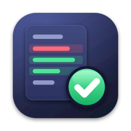
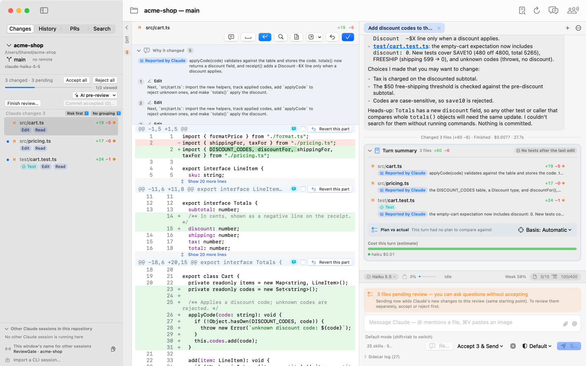
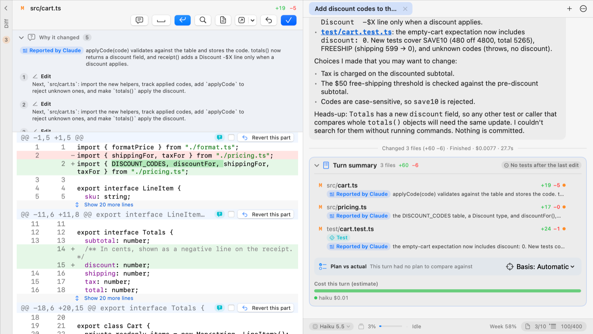
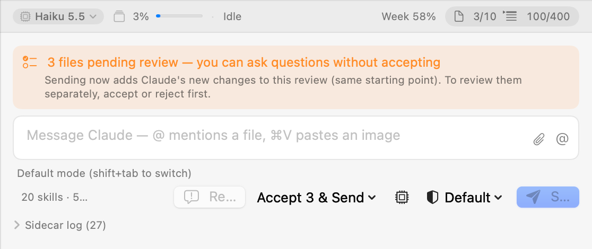
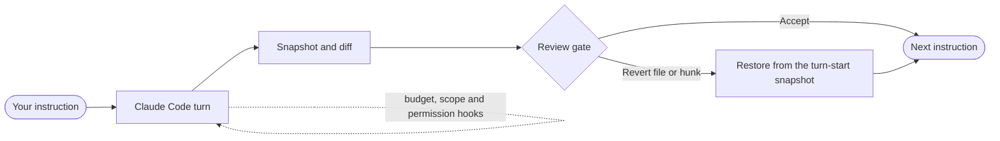

<p align="center">
  
</p>

<h1 align="center">ReviewGate</h1>

<p align="center">
  <b>Review every Claude Code turn before the next one starts.</b>
</p>

<p align="center">
  
  
  <a href="https://github.com/seunggulee1007/reviewgate-for-claude-code/releases/latest"></a>
  <a href="LICENSE"></a>
</p>

<p align="center">
  English · <a href="README.ko.md">한국어</a>
</p>

<p align="center">
  <picture>
    <source media="(prefers-color-scheme: dark)" srcset="docs/images/review-dark.png">
    
  </picture>
  <br><sub>After a turn: the changed files, the diff, and Accept or Revert for each file or hunk.</sub>
</p>

Claude Code writes code faster than anyone can read it. Let it run for an hour and you are left with forty changed
files and no idea which line came from which request.

ReviewGate is a macOS app that puts a gate between turns. When Claude finishes a turn you see exactly what changed and
why, you accept or revert each file, and only then does your next instruction go out.

## Features

**A gate after every turn.** The changed files and their diffs, with Accept or Revert for each file — or for a single
hunk. Accepting never touches your files. Reverting restores the file from a snapshot taken when the turn started, and
leaves your index and commits alone.

**Turn budgets that hold.** Cap how many files and changed lines one turn may touch. The cap is enforced through Claude
Code's hooks: an edit over budget is denied, not merely discouraged.

**Know why it changed.** Every file links back to the tool calls and the reasoning that produced it. A turn summary
compares the plan with what was actually done, marks risky changes and shows the test results.

**Guard rails.** Edits outside the project ask first, writes into `.git/` are refused, and permission requests become
cards in the app instead of terminal prompts. Throwaway files in temporary folders pass quietly.

**Workbenches.** Run several Claude sessions on one project at once — each in its own git worktree and branch, each
with its own gate.

**Pull requests in the same viewer.** Open your GitHub or GitHub Enterprise PRs in the same diff viewer, leave line
comments, or hand a comment thread to Claude.

**Rewind, side questions, sessions.** Edit and retry from an earlier turn, ask a side question without derailing the
turn in progress, and resume earlier sessions together with their review history.

**Keeps itself current.** ReviewGate notices a new release and updates itself in place, after checking the download's
checksum and signature.

<p align="center">
  <picture>
    <source media="(prefers-color-scheme: dark)" srcset="docs/images/why-dark.png">
    
  </picture>
  <br><sub>Why each file changed, beside the turn summary with its cost.</sub>
</p>

<p align="center">
  <picture>
    <source media="(prefers-color-scheme: dark)" srcset="docs/images/budget-dark.png">
    
  </picture>
  <br><sub>The turn budget in the status bar — 3 of 10 files, 100 of 400 lines — and the review waiting before the next instruction.</sub>
</p>

## How it works



At the start of a turn ReviewGate snapshots the working tree (`git write-tree` on a temporary index). When the turn
ends it snapshots again and diffs the two, so the review shows exactly this turn — not your own uncommitted work, not an
earlier turn. Nothing is committed for you; committing stays your call.

All the logic lives in a TypeScript engine that drives the Claude Code CLI. The macOS app (SwiftUI) is a thin client
over the engine's protocol, and so is the Windows client (Electron, preview).

## Requirements

- **macOS 15** or later
- **[Claude Code](https://claude.com/claude-code)**, installed and logged in:
  `curl -fsSL https://claude.ai/install.sh | bash`, then run `claude` once and `/login`
- **Node.js 24** or later — the engine runs on it. Any install works: nvm, Homebrew, volta, fnm, asdf or the official
  installer.
- **Git**
- **[GitHub CLI](https://cli.github.com)** (`gh`), optional — for pull requests and in-app updates

## Install

1. Download `ReviewGate-x.y.z.dmg` from [Releases](https://github.com/seunggulee1007/reviewgate-for-claude-code/releases/latest).
2. Open it and drag **ReviewGate** to **Applications**. The app is notarized by Apple, so it opens like any other
   downloaded app.

After that, updates arrive in the app: a banner offers **Install and Restart**.

**Windows (preview).** The same release has `ReviewGate-Setup-x.y.z.exe`. It is not code-signed, so SmartScreen asks
before the first run (**More info › Run anyway**). It has not been tried on a real Windows machine yet and does not
update itself; [docs/M11-WINDOWS.md](docs/M11-WINDOWS.md) lists what to check.

## Quick start

1. **Open a project** — File › Open Project… (⌘O), drop a folder on the Dock icon, or from a terminal:

   ```sh
   open -a ReviewGate ~/work/my-app
   ```

2. **Tell Claude what to do** in the chat at the bottom. Return sends; Shift-Return starts a new line.
3. **Review the turn.** Go through the changed files and accept or revert each one. Your next instruction goes out once
   the turn is reviewed.
4. **Set a budget** in Settings › Per-turn budget (max files, max changed lines) to keep turns small enough to review.

## Build from source

```sh
brew install xcodegen
make run     # generate the Xcode project, build the engine sidecar, build and launch the app
make test    # Swift, engine and sidecar tests
```

Signing without a developer certificate, versions and releases, the Windows client, the real-CLI test drivers and the
screenshot script are covered in [docs/DEVELOPMENT.md](docs/DEVELOPMENT.md).

## Project layout

| Path | What lives there |
| --- | --- |
| [`engine/`](engine) | The TypeScript engine: review gate, git snapshots, Claude Code sessions and hooks, pull requests |
| [`sidecar/`](sidecar) | The stdio adapter that bundles the engine into the Mac app |
| [`Core/`](Core) | Swift package: protocol types, the engine client, app state |
| [`App/`](App) | The SwiftUI app (English and Korean) |
| [`clients/desktop/`](clients/desktop) | The Electron client for Windows, on the same engine |
| [`docs/PROTOCOL.md`](docs/PROTOCOL.md) | The contract between the apps and the engine |

## License

[MIT](LICENSE) © 2026 leeseunggu

ReviewGate is an independent project and is not affiliated with or endorsed by Anthropic. Claude and Claude Code are
trademarks of Anthropic.
