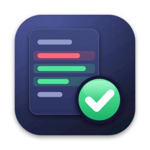
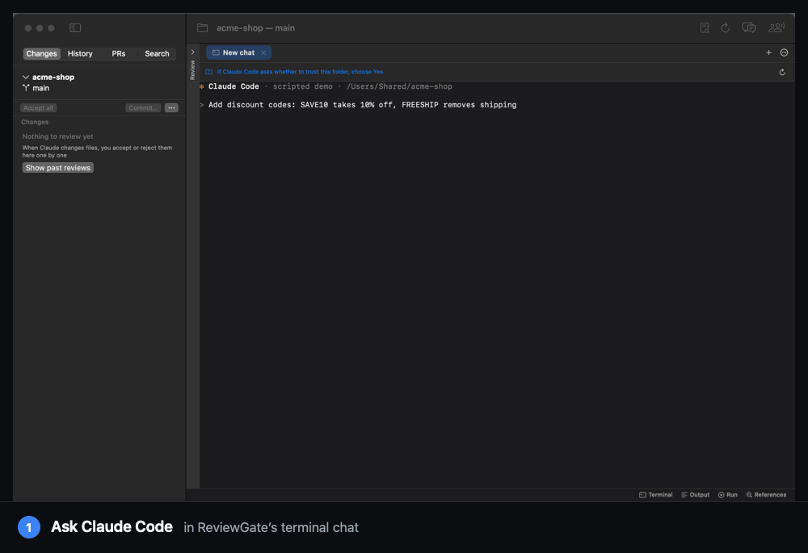
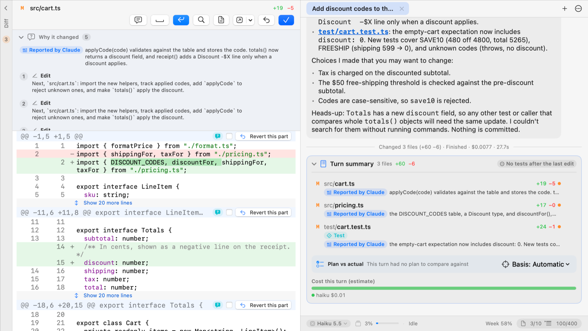

<p align="center">
  
</p>

<h1 align="center">ReviewGate</h1>

<p align="center">
  <b>Review every change Claude Code makes — before it continues.</b>
</p>

<p align="center">
  
  
  
  <a href="https://github.com/seunggulee1007/reviewgate-for-claude-code/releases/latest"></a>
  <a href="LICENSE"></a>
</p>

<p align="center">
  English · <a href="README.ko.md">한국어</a>
</p>

<p align="center">
  
  <br><sub>Recorded from the app itself; Claude's side is a scripted session, so it plays the same every time.</sub>
</p>

## Install

```sh
brew install --cask seunggulee1007/tap/reviewgate
```

If Homebrew says the tap is untrusted, run `brew trust seunggulee1007/tap` once.

Or download the app from [**Releases**](https://github.com/seunggulee1007/reviewgate-for-claude-code/releases/latest):

- **macOS 15+** — `ReviewGate-x.y.z.dmg`. Drag it to Applications; it is notarized, so it opens like any downloaded app.
- **Windows (preview)** — `ReviewGate-Setup-x.y.z.exe`. Not code-signed yet: SmartScreen asks once (**More info › Run anyway**).

Both update themselves from a banner in the app. You also need Claude Code, Node.js 24+ and Git — see [Requirements](#requirements).

## Why ReviewGate

Claude Code writes code faster than anyone can read it. Leave it for an hour and you have forty changed files and no
idea which line came from which request. ReviewGate puts a review between Claude's turns.

- **A gate after every turn.** When Claude finishes, you see exactly what this turn changed — not your own uncommitted
  work, not an earlier turn — and accept or reject each file, or revert single hunks.
- **Review first.** While files wait for review, Claude may fix those files (ask in the chat, or leave notes and request
  changes) but not start on other files. **Accept All & Continue** accepts what's left and lets Claude carry on in one
  click; a file you accepted and Claude changes again shows only what changed since you accepted it.
- **The real Claude Code, in a terminal chat.** Your own Claude Code TUI — slash commands, settings, login — runs inside
  the app, with the review beside it. Prefer a chat view? A classic chat is one setting away.
- **Notes → Request changes.** Leave notes on lines and send them back to Claude as one message. Claude is told what
  you accepted and rejected.
- **Works without git.** A plain folder is tracked through a hidden copy outside it. In a git repository you also get
  commits, branches and workbenches (parallel sessions, each in its own worktree).
- **PR review and code navigation.** Open GitHub pull requests in the same diff viewer and comment on them; ⌘-click to
  peek a definition, find references, jump to a file or symbol.

## How it works

1. **Ask Claude.** Open a project and talk to Claude Code as usual — in the terminal chat or in the chat view.
2. **Claude's turn ends; the review opens.** ReviewGate snapshots the working tree when a turn starts and when it ends,
   and shows the difference: each changed file, its diff and the tool call behind it.
3. **Decide, then continue.** Accept, reject, revert hunks, or leave notes and request changes. Rejected files go back to
   how the turn found them. Then Claude continues — and its next prompt says what you accepted and rejected.

Nothing is committed for you; committing stays your call. The snapshots are `git write-tree` on a temporary index, so
your index, branches and commits are never touched.

## Privacy

Your code and your chats stay on your machine. ReviewGate has no server, no account and no telemetry. It talks only to
Claude Code (which talks to Anthropic exactly as it does in your terminal) and to GitHub, for pull requests (through
your own `gh`) and update checks.

## Requirements

- **macOS 15** or later, or **Windows** (preview)
- **[Claude Code](https://claude.com/claude-code)**, installed and logged in:
  `curl -fsSL https://claude.ai/install.sh | bash`, then run `claude` once and `/login`
- **Node.js 24** or later — the engine runs on it. Any install works: nvm, Homebrew, volta, fnm, asdf or the official
  installer.
- **Git**
- **[GitHub CLI](https://cli.github.com)** (`gh`), optional — for pull requests, and for in-app updates on the Mac

## FAQ

**Does it replace Claude Code?** No. It runs the Claude Code you already have, with your login, settings, skills and MCP
servers. ReviewGate adds the review around it.

**Does accepting change my files or commit anything?** No. Accept only records your decision; the files stay as Claude
left them. Reject puts a file back from the snapshot taken when the turn started. Commits are yours (**Commit…** in the
app, or your own tools).

**Can I turn the gate down?** Yes. Settings › Review: only files under review may change (default), block new prompts
too, or off; a blocked turn can be let through with **Allow for this turn**. A per-turn budget (max files and changed lines, off by default) is in Settings › Session › Limits.

**Does it cost anything?** ReviewGate is free and MIT-licensed. Claude usage is billed by your Claude Code plan, as
always.

**Is Windows supported?** As a preview: the same engine and review in an Electron client. It updates itself from the app;
the installer is not code-signed yet.

## More features

<p align="center">
  <picture>
    <source media="(prefers-color-scheme: dark)" srcset="docs/images/why-dark.png">
    
  </picture>
  <br><sub>Why each file changed, beside the turn summary with its cost.</sub>
</p>

**Know why it changed.** Every file links back to the tool calls and the reasoning that produced it. A turn summary
compares the plan with what was actually done, marks risky changes and shows the test results.

**Turn budgets that hold, when you want one.** A cap on how many files and changed lines one turn may touch, enforced
through Claude Code's hooks: an edit over budget is denied, not merely discouraged.

**Guard rails.** Edits outside the project ask first, writes into `.git/` are refused, and permission requests become
cards in the app. Throwaway files in temporary folders pass quietly.

**Code navigation while you review.** ⌘-click a name in any diff or file to peek its definition in a band under the
line — the place you read never moves — or F12 to jump there; hold ⌘ over a name for its signature. Java, Kotlin,
JavaScript / TypeScript, Vue and JSP above all. References fill a tab of the bottom panel (F4 steps through them); Go to
File (⌘P), Symbols in This File (⌘F12) and Symbols in Project (⌥⌘⇧N) find the rest; open the line in IntelliJ IDEA,
VS Code or Xcode. Search-based with an in-memory symbol index — no language server to set up.

**A bottom panel, as in your editor.** Shell tabs in the project folder (⌃`), an Output tab with every Bash command
Claude ran, and a Run tab for the project's own commands — `npm run dev`, `./gradlew bootRun`, `./mvnw test` or your
own — each with Run, Stop and Restart. Nothing runs until you click.

**Workbenches.** Several Claude sessions on one project at once, each in its own git worktree and branch, each with its
own gate. "New Chat in a Workbench" (⌥⌘T) starts one without waiting for the current chat.

**Start from a task.** Give a GitHub issue (read with `gh`) or a Jira, Linear or other tracker link (read by Claude
through the MCP server you pick): ReviewGate makes its branch or workbench and drafts the first prompt for you to send.

**Pull requests in the same viewer.** Your GitHub or GitHub Enterprise PRs with their conversation, line comments and
files; hand a comment thread to Claude.

**Rewind, side questions, sessions.** Edit and retry from an earlier turn, ask a side question without derailing the
turn in progress, and resume earlier sessions with their review history.

**Keeps itself current.** A new release shows as a banner; the download's checksum and signature are checked before it
installs in place.

## Quick start

1. **Open a project** — File › Open Project… (⌘O), drop a folder on the Dock icon, or from a terminal:

   ```sh
   open -a ReviewGate ~/work/my-app
   ```

   A folder that is not a git repository can be made one, or tracked without git (no `.git` is added to it).

2. **Tell Claude what to do** — in the terminal chat (new chats are terminal chats by default) or the chat view.
3. **Review the turn** — accept or reject each file, then continue.

Keyboard shortcuts are listed in [docs/SHORTCUTS.md](docs/SHORTCUTS.md).

## Build from source

```sh
brew install xcodegen
make run     # generate the Xcode project, build the engine sidecar, build and launch the app
make test    # Swift, engine and sidecar tests
```

Signing without a developer certificate, versions and releases, the Windows client, the real-CLI test drivers and the
screenshot and demo scripts are covered in [docs/DEVELOPMENT.md](docs/DEVELOPMENT.md).

All the logic lives in a TypeScript engine that drives the Claude Code CLI. The macOS app (SwiftUI) is a thin client
over the engine's protocol, and so is the Windows client (Electron).

| Path | What lives there |
| --- | --- |
| [`engine/`](engine) | The TypeScript engine: review gate, git snapshots, Claude Code sessions and hooks, pull requests |
| [`sidecar/`](sidecar) | The stdio adapter that bundles the engine into the Mac app |
| [`Core/`](Core) | Swift package: protocol types, the engine client, app state |
| [`App/`](App) | The SwiftUI app (English and Korean) |
| [`clients/desktop/`](clients/desktop) | The Electron client for Windows, on the same engine |
| [`docs/PROTOCOL.md`](docs/PROTOCOL.md) | The contract between the apps and the engine |

<!-- The development story (in Korean): a link line goes here once the blog series is public. -->

## License

[MIT](LICENSE) © 2026 leeseunggu

ReviewGate is an independent project and is not affiliated with or endorsed by Anthropic. Claude and Claude Code are
trademarks of Anthropic.
